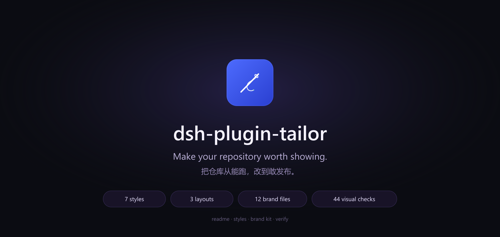
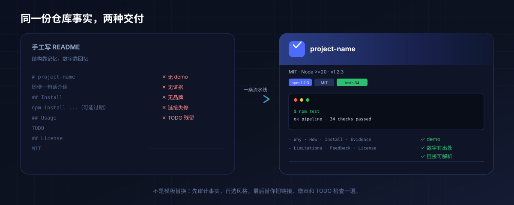
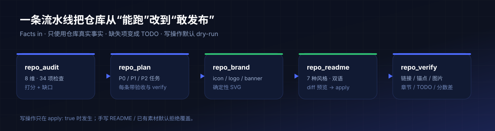

<p align="center">
  
</p>

<p align="center">
  <a href="README.md">简体中文</a> · <b>English</b>
</p>

<p align="center">
  <a href="https://www.npmjs.com/package/dsh-plugin-tailor"></a>
  
  
  
  <a href="LICENSE"></a>
  
  
</p>

<p align="center"><sub><b>44 checks</b> · <b>18/18 tests</b> · <b>7 styles</b> · <b>3 layouts</b> · <b>12 brand files</b> · MIT</sub></p>

## What it does

<p align="center">
  
</p>

<p align="center"><sub>The same repository: hand-written README → tailor output. First screen, demo, evidence, brand and link checks in one pass.</sub></p>

This repository is rebuilt with itself: audit score **37 → 100** (D → A). `dsh-plugin-resolver` reaches **81/100 · verify PASS** with the same toolchain.

## Install

```sh
# 1) DSH plugin (recommended)
dsh plugin --profile <profile> add dsh-plugin-tailor

# 2) CLI (no DSH required)
npm install -g dsh-plugin-tailor
dsh-repo-tailor styles

# 3) Offline: source or Release tarball
git clone https://github.com/sakikoTGW/dsh-plugin-tailor
```

Hand this to your agent:

```text
Audit this repository with dsh-plugin-tailor, rewrite the README and brand assets in the product style, then run verify.
```

## How it works

<p align="center">
  
</p>

| Stage | Tool | Result |
|---|---|---|
| Audit | `repo_audit` | 8 dimensions, 44 checks, 0–100 score, impact-ordered gaps |
| Plan | `repo_plan` | P0/P1/P2 tasks with acceptance and verify command |
| Brand | `repo_brand` | 12 deterministic SVGs + contrast QA |
| README | `repo_readme` | bilingual draft, layout engine, diff, write protection |
| Verify | `repo_verify` | links, images, anchors, sections, TODO, PASS/FAIL |

Writes default to dry-run; hand-written READMEs and existing assets stay untouched unless `force` is set.

## Ecosystem

- [dsh-plugins](https://github.com/sakikoTGW/dsh-plugins) — plugin set and catalog
- [dsh-plugin-resolver](https://github.com/sakikoTGW/dsh-plugin-resolver) — install the right plugin in one call
- npm: [dsh-plugin-tailor](https://www.npmjs.com/package/dsh-plugin-tailor)
- Style catalog and schema: [styles/README.md](styles/README.md)

## Capability matrix

| Tool | Access | Input | Output |
|---|---|---|---|
| `repo_styles` | read | `path?`, `json?` | builtin + custom styles, origins, validation errors |
| `repo_audit` | read | `path`, `style?` | score, dimension detail, gaps |
| `repo_plan` | read | `path`, `style?`, `limit?` | P0/P1/P2 + acceptance + verify |
| `repo_readme` | dry-run / write | `path`, `style?`, `lang?`, `apply?`, `force?` | diff, TODO, style gaps |
| `repo_brand` | dry-run / write | `path`, `style?`, `concept?`, `apply?`, `force?` | 12 brand files |
| `repo_verify` | read | `path`, `style?` | PASS/FAIL, checks, remaining TODO |

## Features

- **7 styles + 3 layouts** — styles are JSON; `editorial` / `centered` / `showcase` come from the `visual` field.
- **Custom styles** — drop into `.tailor/styles/` or `~/.tailor/styles/`, with `extends` and schema validation.
- **12-file brand kit** — icon / maskable / light+dark logo / light+dark wordmark / light+dark banner / social / brand-sheet / tokens / index.
- **Visual QA** — WCAG contrast on the palette, plus 14 brand and visual checks.
- **Bilingual** — zh / en pages share one fact source.
- **Pre-publish verification** — broken links, images, anchors, missing sections and remaining TODO in one PASS/FAIL command.

## Validation

```sh
npm test                                         # 18/18
node bin/tailor.mjs verify . --style=evidence    # PASS
node bin/tailor.mjs audit . --style=evidence     # 100/100
```

## Agent contract

```json
{
  "tools": ["repo_styles", "repo_audit", "repo_plan", "repo_readme", "repo_brand", "repo_verify"],
  "styles": "JSON presets with extends + schema validation",
  "writes": ["README.md", "README.en.md", "assets/*.svg", "assets/README.md", ".tailor/baseline.json"],
  "safety": "dry-run default; hand-written README and existing assets preserved unless force",
  "verify": "links, images, anchors, required sections, remaining TODO"
}
```

## Closing

From "it runs" to "ship it".

[npm](https://www.npmjs.com/package/dsh-plugin-tailor) · [GitHub](https://github.com/sakikoTGW/dsh-plugin-tailor) · [Issues](https://github.com/sakikoTGW/dsh-plugin-tailor/issues) · [dsh-plugins](https://github.com/sakikoTGW/dsh-plugins)

<p align="center"><sub>Built for <a href="https://github.com/deepseek-ai/deepseek-harness">DeepSeek Harness</a> · MIT · <a href="#">Back to top ↑</a></sub></p>

