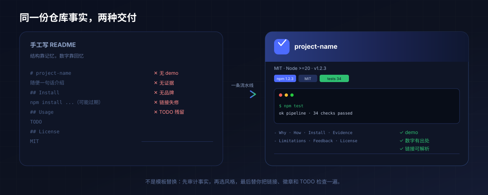
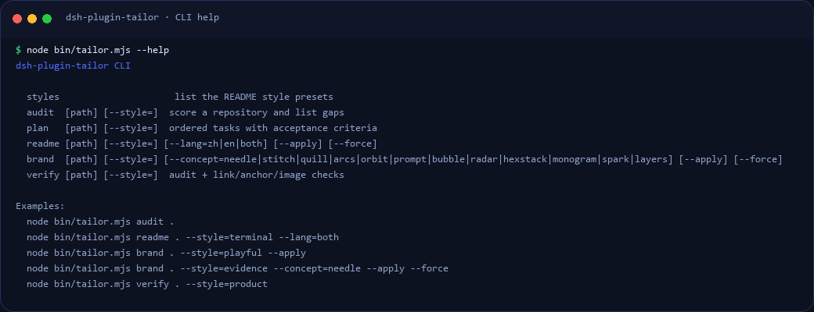
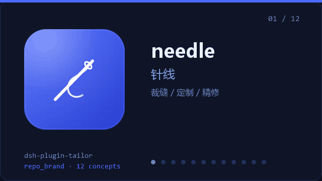
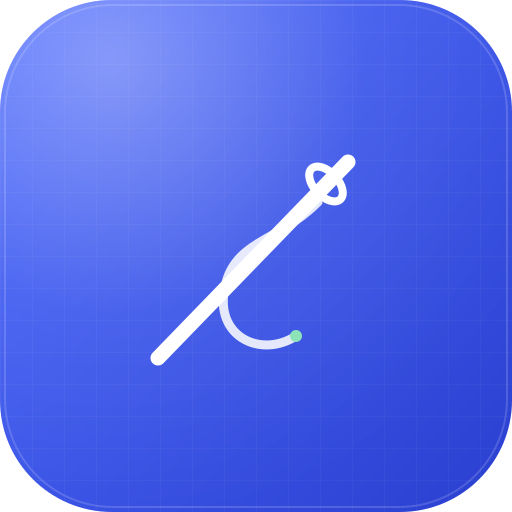
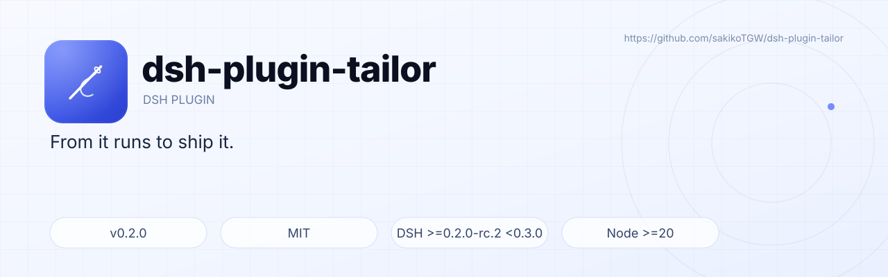
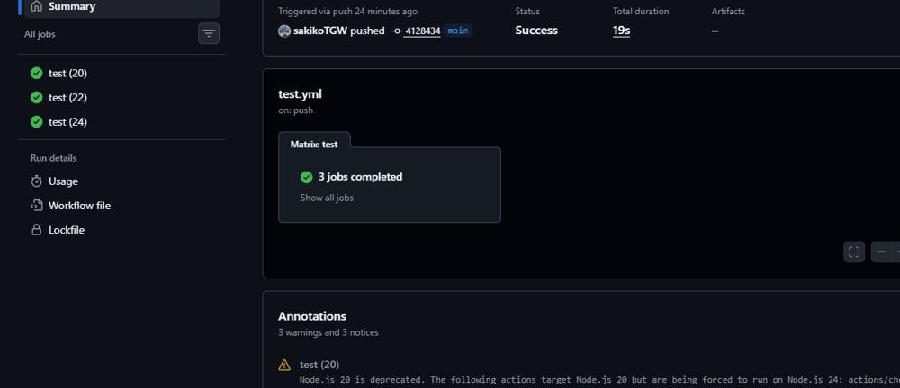

<!-- generated-by: dsh-plugin-tailor style=evidence lang=en (draft scaffold, hand-polished) -->

<p align="center">
  
</p>

<p align="center">
  <a href="README.md">简体中文</a> · <b>English</b>
</p>

<p align="center">
  
  <a href="https://github.com/sakikoTGW/dsh-plugin-tailor/releases"></a>
  
  
  
  <a href="https://github.com/sakikoTGW/dsh-plugin-tailor/actions/workflows/test.yml"></a>
  
</p>

# dsh-plugin-tailor

> From “it runs” to “ship it”: audit → pick a style → brand assets → bilingual README → pre-release verification.

<p align="center"><sub>MIT · Node &gt;=20 · DSH &gt;=0.2.0-rc.2 &lt;0.3.0 · v0.3.2</sub></p>

<p align="center">
  <a href="#quickstart"><b>Install</b></a> · <a href="#seven-styles">Seven styles</a> · <a href="#six-tools">Six tools</a> · <a href="#roadmap">Roadmap</a>
</p>

<p align="center">
  
</p>

<p align="center">
  
</p>
<p align="center"><sub>Real output: <code>tailor audit ../dsh-plugin-resolver</code> and <code>tailor verify …</code> (<a href="demo/demo.tape">VHS tape</a> to re-record)</sub></p>

## Contents

- [Why it exists](#why-it-exists)
- [How it works](#how-it-works)
- [Features](#features)
- [Quickstart](#quickstart)
- [Six tools](#six-tools)
- [Seven styles](#seven-styles)
- [Brand assets](#brand-assets)
- [Tool output](#tool-output)
- [Results and evidence](#results-and-evidence)
- [Layout](#layout)
- [Tests and CI](#tests-and-ci)
- [Known limitations](#known-limitations)
- [Security boundaries](#security-boundaries)
- [FAQ](#faq)
- [Roadmap](#roadmap)
- [Ecosystem and listings](#ecosystem-and-listings)
- [Feedback and security](#feedback-and-security)
- [License](#license)

## Why it exists

- **READMEs stop at “it runs”**: install commands hidden in docs, a random screenshot as the demo, no limitations section. The better the project, the more it loses on presentation.
- **Every repository means redoing the same work**: first screen, badges, TOC, assets, release checks — and no reusable style.
- **Nobody checks before release**: broken relative links, anchors, images, leftover TODOs, stale test counts — readers find them first.
- **“Beautiful” has no standard**: instead of copying one template, this plugin distils what good repositories share into selectable style presets plus executable checks.

What it does: **8 dimensions / 34 checks** for maturity, **7 style presets** for the README, **deterministic SVG** for brand assets, and one `repo_verify` before you publish.

<p align="center">
  
</p>

## How it works

<p align="center">
  
</p>

1. **`repo_audit`** reads `package.json`, README, assets, CI and git state, scores 8 dimensions / 34 checks, and returns gaps sorted by impact.
2. **`repo_plan`** turns gaps into P0/P1/P2 tasks with acceptance criteria and the exact `repo_verify` command; style gaps (no GIF, no screenshots, no English page) become tasks too.
3. **`repo_brand`** generates `icon.svg` / `logo.svg` / `banner.svg` / `social-preview.svg` from the style palette and mark — deterministic, no image model, never overwrites existing files.
4. **`repo_readme`** assembles zh/en drafts from repository facts only; missing facts become `TODO(tailor)` markers; dry-run prints a diff, `apply` writes.
5. **`repo_verify`** re-runs the audit plus relative-link, image, anchor, badge, required-section and leftover-TODO checks, and reports PASS/FAIL with the baseline score delta.

## Features

<p align="center">
  
</p>

- **8 dimensions / 34 checks**: identity, first screen, install, docs, evidence, release, community, brand — every gap comes with a concrete fix, not just a score.
- **7 styles + bilingual drafts**: from evidence-first to minimal typography; dry-run diff first, write second.
- **12 vector concepts × light/dark**: `icon` / `logo` (light+dark) / `banner` (light+dark) / `social` / `brand-sheet` — 8 files, byte-identical on re-run.
- **Write protection**: hand-written READMEs, existing assets and dirty worktrees are refused unless `force` is explicit.
- **Pre-release verification**: relative links, images, anchors, badges, required sections and leftover TODOs in one PASS/FAIL command.
- **CLI and DSH tools share one logic layer**: `bin/tailor.mjs` calls the same code as the six tools, so the terminal reproduces the agent.

## Quickstart

> **Not on npm yet. v0.3.1 ships as a [GitHub Release](https://github.com/sakikoTGW/dsh-plugin-tailor/releases/tag/v0.3.2) with a `.tgz`. Either path works:**

```sh
# from source
git clone https://github.com/sakikoTGW/dsh-plugin-tailor
dsh plugin --profile <profile> add /path/to/dsh-plugin-tailor

# or the release tarball
dsh plugin --profile <profile> add /path/to/dsh-plugin-tailor-0.3.2.tgz
```

Restart the engine once and the six `repo_*` tools are live. After that, edits under `logic/` apply on the next call; edits to `host/register.js` or `index.js` need an engine restart.

The CLI uses the same logic and needs no DSH host:

```sh
node bin/tailor.mjs styles                    # list the 7 styles
node bin/tailor.mjs audit . --style=terminal   # score + gaps
node bin/tailor.mjs plan . --style=terminal    # task list
node bin/tailor.mjs brand . --style=playful --apply
node bin/tailor.mjs readme . --style=evidence --lang=both
node bin/tailor.mjs verify . --style=evidence
```

<p align="center">
  
</p>
<p align="center"><sub><code>tailor --help</code>: six commands and examples, same logic as the DSH tools.</sub></p>

From DSH:

```text
repo_audit  { path: ".", style: "terminal" }
repo_plan   { path: ".", style: "terminal" }
repo_readme { path: ".", style: "terminal", lang: "both" }
repo_brand  { path: ".", style: "terminal", apply: true }
repo_verify { path: ".", style: "terminal" }
```

## Six tools

| Tool | R/W | Arguments | Returns |
|---|---|---|---|
| `repo_styles` | read | — | id, language, hero, demo, source and essence for the 7 presets |
| `repo_audit` | read | `path`, `style?` | 0-100 score, 8-dimension breakdown, impact-sorted gaps, style gaps |
| `repo_plan` | read | `path`, `style?`, `limit?` | P0/P1/P2 tasks with acceptance criteria and verify command |
| `repo_readme` | dry-run / write | `path`, `style?`, `lang?`, `apply?`, `force?` | diff, TODO list, style gaps |
| `repo_brand` | dry-run / write | `path`, `style?`, `concept?`, `tagline?`, `apply?`, `force?` | 8 files (12 concepts) |
| `repo_verify` | read | `path`, `style?` | PASS/FAIL, per-check detail, leftover TODOs, score delta |

Writes are dry-run by default; hand-written READMEs and existing assets are refused/skipped unless `force`; a dirty worktree is refused without `force`.

## Seven styles

<p align="center">
  
</p>

| id | Style | Language | Hero | Demo | Default concept | Best for |
|---|---|---|---|---|---|---|
| `evidence` | Evidence-first | bilingual | banner | GIF | `arcs` | engineering repos with benchmarks/tests |
| `terminal` | Terminal tool | bilingual | centered logo | GIF | `prompt` | CLI tools with a real logo |
| `mobile` | Mobile · community | zh-first | banner | screenshots | `orbit` | apps / mobile / community products |
| `playful` | GIF-first tutorial | en-first | logo | GIF | `bubble` | TUIs and developer tools |
| `product` | Product page | en-first | brand banner | screenshots | `radar` | end-user products |
| `platform` | Panel platform | bilingual | centered logo | GIF | `hexstack` | panels and platforms |
| `minimal` | Minimal type | en-first | none | none | `monogram` | mature tools / frameworks |

How to choose, each preset's section order, and the “12 things good repositories share” live in [docs/STYLES.md](docs/STYLES.md).

## Brand assets

<p align="center">
  
</p>

`repo_brand` is not a template swap: pick one of 12 hand-built geometric concepts, combined with the style palette and light/dark layouts.

<p align="center">
  
</p>
<p align="center"><sub>12 concepts, one per frame; the full contact sheet is above.</sub></p>

<table align="center">
  <tr>
    <td align="center" valign="middle"><br><sub>logo-dark</sub></td>
    <td align="center" valign="middle"><br><sub>icon</sub></td>
  </tr>
</table>

<p align="center">
  
</p>
<p align="center"><sub>Light and dark banners/logos: dark for the README, light for docs and slides.</sub></p>

| Concept | Best for | Concept | Best for |
|---|---|---|---|
| `needle` | tailoring / custom / craft | `stitch` | done / verify / delivery |
| `quill` | writing / docs / narrative | `arcs` | growth / metrics / evidence |
| `orbit` | network / remote / connection | `prompt` | CLI / terminal / tools |
| `bubble` | product / interaction / light | `radar` | monitoring / scanning / security |
| `hexstack` | platform / panel / layers | `monogram` | mature tools / minimal |
| `spark` | generic / brand / highlight | `layers` | architecture / modules / reuse |

One run writes 8 files:

| File | Purpose |
|---|---|
| `icon.svg` | 512×512 icon / avatar |
| `logo.svg` / `logo-dark.svg` | light / dark lockups |
| `banner.svg` / `banner-light.svg` | 1280×400 dark / light banners |
| `social-preview.svg` | 1280×640 social card |
| `brand-sheet.svg` | 12 concepts side by side, default highlighted |
| `assets/README.md` | asset index + switch commands |

```sh
node bin/tailor.mjs brand . --style=evidence --concept=needle \
  --tagline="From it runs to ship it." --apply --force
```

Dry-run lists files and concepts; `apply` writes, and existing files are skipped by default.

## Tool output

Real CLI output, not mockups; each screenshot is rendered from the actual stdout with the command in the frame.

<p align="center">
  
</p>
<p align="center"><sub><code>tailor styles</code>: describes styles only, no repository names.</sub></p>

<p align="center">
  
</p>
<p align="center"><sub><code>tailor brand . --style=evidence --concept=needle</code>: dry-run lists 8 files and 12 concepts.</sub></p>

<p align="center">
  
</p>
<p align="center"><sub><code>tailor verify</code>: on PASS it reports links, images, anchors, sections and leftover TODOs.</sub></p>

## Results and evidence

<p align="center">
  
</p>

- **Self-audit**: this repository used itself to add docs, brand assets and README — score **37 → 100** (D → A). `dsh-plugin-resolver` audits at **84/100 (B)** and `repo_verify` returns `PASS`.
- **Tests**: 11 offline tests (`npm test`, pass 11 / fail 0); CI runs on Node 20/22/24.
- **Pure logic**: `auditFacts` **0.01 ms**, `renderReadme` **0.03 ms**, `verifyFacts` **0.03 ms**; `collectFacts` is **109–794 ms** because it spawns 4 `git` processes (depends on repository size).
- **CLI end-to-end**: `tailor audit .` median **248 ms**, of which ~200 ms is Node startup.
- **Method**: environment, procedure and output sizes are in [BENCHMARK.md](BENCHMARK.md); before/after and test output are in [docs/EVIDENCE.md](docs/EVIDENCE.md).

## Layout

```text
index.js            host half: tool registration + hot-loaded logic
host/register.js    tool schemas (stable; restart to change)
logic/
  api.js            six tool entry points
  facts.mjs         read-only repository facts
  rubric.mjs        8 dimensions / 34 checks
  plan.mjs          gaps → P0/P1/P2 tasks
  styles.mjs        seven style presets (pure data)
  readme.mjs        bilingual drafts, diff, apply safety
  brand.mjs         12-concept brand engine (light + dark)
  verify.mjs        links / anchors / images / sections / TODOs
  util.mjs          diff, slug, path boundary
bin/tailor.mjs      CLI (same logic as the tools)
bench/micro.mjs     pure-logic microbenchmark
docs/               SPEC / STYLES / ACCEPTANCE / EVIDENCE
test/tailor.test.mjs 11 offline tests
```

## Tests and CI

```sh
npm test                # 11 offline tests
node bench/micro.mjs .  # pure-logic microbenchmark
node bin/tailor.mjs verify . --style=evidence
```

- Coverage: style registry, facts, audit ordering, plan, README rendering/write safety, deterministic brand, broken links/images/anchors, host registration, CLI.
- CI: `.github/workflows/test.yml`, Node 20/22/24 matrix, runs `npm test`, a CLI smoke test and `npm pack --dry-run`.

<p align="center">
  
</p>
<p align="center"><sub>Real CI: the Node 20 / 22 / 24 jobs all pass in 19 seconds.</sub></p>

## Known limitations

- **The score measures structure and evidence presence, not prose quality**: 100 does not mean the README is pleasant to read; a human still decides.
- **Drafts must be reviewed**: `TODO(tailor)` markers are for you to fill; `repo_verify` reports leftover TODOs as a warning.
- **zh / en only**, no auto style selection, no auto commit / push / publish.
- **No real screenshots or images**: `repo_brand` only generates SVG geometry; the demo GIF must be recorded from a real run.
- **Brand assets are geometric SVG, not illustration/photography**: illustration-level work still needs a human or an image model; `repo_brand` guarantees concept choice, light/dark pairs, consistency and reproducibility.
- **`collectFacts` dominates runtime** (git subprocesses + directory walk); the judgement logic itself is effectively free.
- **SVG text metrics depend on system fonts** (Inter / Segoe UI / Microsoft YaHei), so widths vary slightly across machines.
- Not on npm yet: install from source; release steps are in [PUBLISHING.md](PUBLISHING.md).

## Security boundaries

| Action | Boundary |
|---|---|
| Read | repository files only, plus `git status/log/tag`; the plugin makes no network requests |
| Write (only with `apply: true`) | `README.md` / `README.en.md` / `assets/*.svg` / `assets/README.md` / `.tailor/baseline.json` |
| Refuse | path traversal (`../`), hand-written README without `force`, existing assets without `force`, dirty worktree without `force` |
| Never | execute repository scripts, run `npm install`, commit / push / publish, call an image model |
| Dependencies | Node standard library only; zero runtime dependencies |

## FAQ

**How is this different from a README template?**
A template gives structure; this gives an 8-dimension audit, style-based generation, write protection and pre-release verification. Facts come from the repository; missing ones become TODOs, never invented numbers.

**Will it overwrite my hand-written README?**
No by default. Only files with a `generated-by` marker may be regenerated; otherwise `force` is required.

**Does it need network access?**
No. Badge images are loaded by GitHub from shields.io at render time; the plugin itself makes no requests.

**Which languages and styles are supported?**
`zh` / `en` pages; seven styles: `evidence`, `terminal`, `mobile`, `playful`, `product`, `platform`, `minimal`. Legacy ids still work.

**Why review the README after a 100 score?**
The score measures structure, evidence and brand presence — not prose quality or factual correctness. A human still reads it before publishing.

**When will it be on npm?**
See the roadmap. For now use the `.tgz` attached to the GitHub Release.

## Roadmap

- [x] **v0.1** 8-dimension audit, P0–P2 planning, bilingual drafts, pre-release verification
- [x] **v0.2** 12 original vector concepts, light/dark brand kit, brand sheet
- [x] **v0.3** style-only presets, real CLI screenshots, re-recorded demo
- [ ] **v0.4** npm publish + `dsh-plugins` hub listing
- [ ] **v0.4** `--palette` variants (warm / high-contrast / mono / follow brand)
- [ ] **v0.5** side-by-side style previews from a real repository
- [ ] **v0.5** optional image-model illustration mode (PNG, SVG geometry stays the default)

## Ecosystem and listings

- Install helper: [`dsh-plugin-resolver`](https://github.com/sakikoTGW/dsh-plugin-resolver) (installs the right version in one tool call)
- Index: [`dsh-plugins`](https://github.com/sakikoTGW/dsh-plugins) (`catalog.json` is the source of truth)
- Mobile adaptation: [`dsh-plugin-resolver-dshgo`](https://github.com/sakikoTGW/dsh-plugin-resolver-dshgo)
- Listing status: GitHub Release ✅ · npm ⏳ · hub catalog ⏳

## Feedback and security

- Issues and ideas: <https://github.com/sakikoTGW/dsh-plugin-tailor/issues>
- Security: use **Security → Advisories → Report a vulnerability** (private, see [SECURITY.md](SECURITY.md))
- Contributing: [CONTRIBUTING.md](CONTRIBUTING.md) · Release process: [PUBLISHING.md](PUBLISHING.md)

## License

[MIT](LICENSE)

<p align="center">
  <sub>Built for <a href="https://github.com/deepseek-ai/deepseek-harness">DeepSeek Harness</a> · part of <a href="https://github.com/sakikoTGW/dsh-plugins">dsh-plugins</a> · <a href="#dsh-plugin-tailor">back to top ↑</a></sub>
</p>
<p align="center">
  <sub>If it saved you time, a ⭐ helps others find it.</sub>
</p>
