<!-- generated-by: dsh-plugin-tailor style=evidence lang=zh (draft scaffold, hand-polished) -->

<p align="center">
  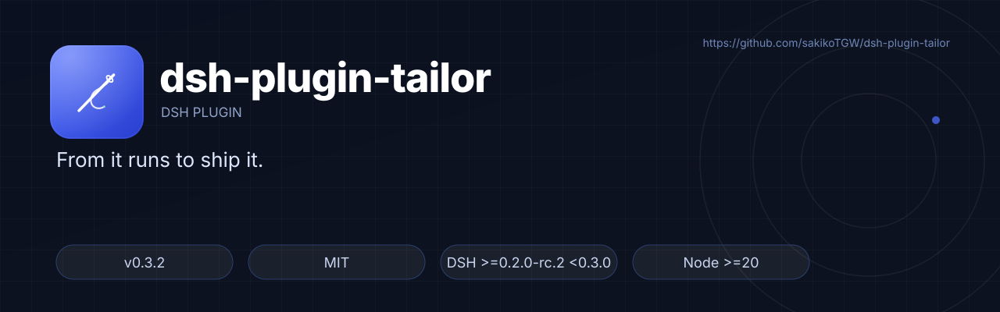
</p>

<p align="center">
  <b>简体中文</b> · <a href="README.en.md">English</a>
</p>

<p align="center">
  
  <a href="https://github.com/sakikoTGW/dsh-plugin-tailor/releases"></a>
  
  
  
  <a href="https://github.com/sakikoTGW/dsh-plugin-tailor/actions/workflows/test.yml"></a>
  
</p>

# dsh-plugin-tailor

> 把仓库从「能跑」改到「敢发布」：审计 → 选风格 → 品牌素材 → 双语 README → 发布前校验。

<p align="center"><sub>MIT · Node &gt;=20 · DSH &gt;=0.2.0-rc.2 &lt;0.3.0 · v0.3.1</sub></p>

<p align="center">
  <a href="#快速开始"><b>安装</b></a> · <a href="#七种风格">七种风格</a> · <a href="#六个工具">六个工具</a> · <a href="#路线图">路线图</a>
</p>

<p align="center">
  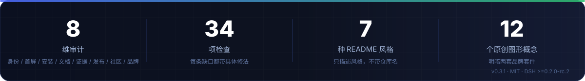
</p>

<p align="center">
  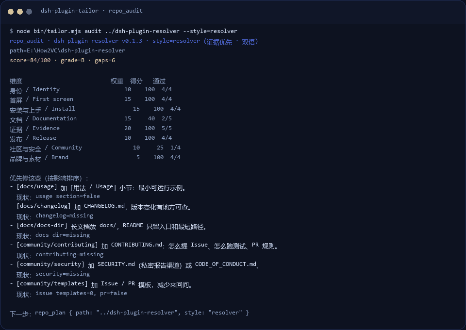
</p>
<p align="center"><sub>真实输出：<code>tailor audit ../dsh-plugin-resolver</code> 与 <code>tailor verify …</code>（<a href="demo/demo.tape">VHS tape</a> 可重录）</sub></p>

## 目录

- [为什么需要它](#为什么需要它)
- [怎么工作](#怎么工作)
- [功能](#功能)
- [快速开始](#快速开始)
- [六个工具](#六个工具)
- [七种风格](#七种风格)
- [品牌素材](#品牌素材)
- [工具输出](#工具输出)
- [效果与证据](#效果与证据)
- [结构](#结构)
- [测试与 CI](#测试与-ci)
- [已知限制](#已知限制)
- [权限与安全边界](#权限与安全边界)
- [FAQ](#faq)
- [路线图](#路线图)
- [生态与收录](#生态与收录)
- [反馈与安全](#反馈与安全)
- [License](#license)

## 为什么需要它

- **README 停在“能跑”**：安装命令藏在 docs、demo 是随手截图、限制一条不写；项目越好，越吃亏在表达。
- **每换一个仓库就重做一遍**：首屏、徽章、目录、素材、发布检查，全是重复劳动，风格还无法复用。
- **发布前没人检查**：相对链接、锚点、图片、TODO、测试数量过期，通常等读者发现。
- **“好看”没有标准**：与其模仿某一个模板，不如把优秀仓库的共性拆成可选的风格预设 + 可执行的检查项。

本插件做的事：把仓库成熟度拆成 **8 维 34 项检查**，把 README 风格拆成 **7 个预设**，把品牌素材变成**确定性 SVG**，把发布前检查变成一条 `repo_verify`。

## 怎么工作

<p align="center">
  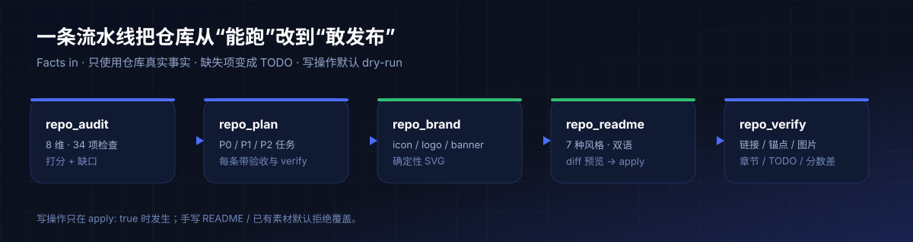
</p>

1. **`repo_audit`**：读 `package.json`、README、assets、CI、git 状态，按 8 维 34 项检查打分，输出按影响排序的缺口。
2. **`repo_plan`**：把缺口变成 P0/P1/P2 任务；每条带验收标准与 `repo_verify` 命令，风格缺口（缺 GIF、缺截图、缺英文页）也进任务。
3. **`repo_brand`**：按所选风格的调色板与图标字形，生成 `icon.svg` / `logo.svg` / `banner.svg` / `social-preview.svg`；确定性、无图片模型、不覆盖已有文件。
4. **`repo_readme`**：按风格组装 zh/en 草稿；只使用仓库真实事实，缺失项变成 `TODO(tailor)`；默认 dry-run 给 diff，`apply` 才落盘。
5. **`repo_verify`**：复跑审计 + 相对链接、图片、锚点、徽章、必需章节、剩余 TODO 检查，报告 PASS/FAIL 与 baseline 分数差。

## 功能

<p align="center">
  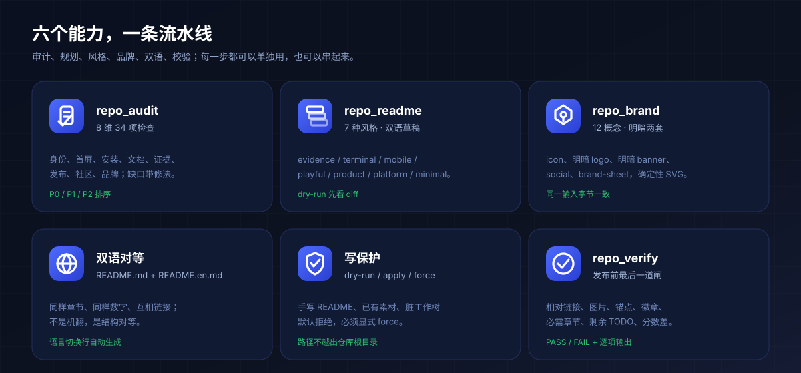
</p>

- **8 维 34 项审计**：身份、首屏、安装、文档、证据、发布、社区、品牌；每条缺口都带具体修法，不只是打分。
- **7 种风格 + 双语草稿**：从证据优先到极简排版，先看 diff 再落盘。
- **12 个原创图形概念 × 明暗双版**：`icon` / `logo`（明暗）/ `banner`（明暗）/ `social` / `brand-sheet` 共 8 个文件；同一仓库重复生成字节一致。
- **写保护**：手写 README、已有素材、脏 worktree 默认拒绝，必须显式 `force`。
- **发布前校验**：相对链接、图片、锚点、徽章、必需章节、剩余 TODO，一条命令给出 PASS/FAIL。
- **CLI 与 DSH 工具同源**：`bin/tailor.mjs` 和六个工具调用同一套 logic，终端里能复现。

## 快速开始

> **npm 尚未发布。v0.3.1 已打进 [GitHub Release](https://github.com/sakikoTGW/dsh-plugin-tailor/releases/tag/v0.3.1)（含 `.tgz`）。二选一：**

```sh
# 源码
git clone https://github.com/sakikoTGW/dsh-plugin-tailor
dsh plugin --profile <profile> add /path/to/dsh-plugin-tailor

# 或 Release 里的 tarball
dsh plugin --profile <profile> add /path/to/dsh-plugin-tailor-0.3.1.tgz
```

装完重启一次引擎，六个 `repo_*` 工具上线。之后改 `logic/` 下一次调用即生效，改 `host/register.js` 或 `index.js` 需要重启引擎。

不装插件也能用 CLI，和工具走同一套逻辑：

```sh
node bin/tailor.mjs styles                    # 列出 7 种风格
node bin/tailor.mjs audit . --style=terminal   # 打分 + 缺口
node bin/tailor.mjs plan . --style=terminal    # 任务清单
node bin/tailor.mjs brand . --style=playful --apply
node bin/tailor.mjs readme . --style=evidence --lang=both
node bin/tailor.mjs verify . --style=evidence
```

在 DSH 里直接调用：

```text
repo_audit  { path: ".", style: "terminal" }
repo_plan   { path: ".", style: "terminal" }
repo_readme { path: ".", style: "terminal", lang: "both" }
repo_brand  { path: ".", style: "terminal", apply: true }
repo_verify { path: ".", style: "terminal" }
```

## 六个工具

| 工具 | 读写 | 主要参数 | 返回 |
|---|---|---|---|
| `repo_styles` | 读 | — | 7 个风格的 id、语言、hero、demo、来源、essence |
| `repo_audit` | 读 | `path`, `style?` | 0-100 分、8 维明细、按影响排序的 gaps、风格缺口 |
| `repo_plan` | 读 | `path`, `style?`, `limit?` | P0/P1/P2 任务，每条带 acceptance 与 verify |
| `repo_readme` | dry-run / 写 | `path`, `style?`, `lang?`, `apply?`, `force?` | diff、TODO 清单、风格缺口 |
| `repo_brand` | dry-run / 写 | `path`, `style?`, `concept?`, `tagline?`, `apply?`, `force?` | 8 个文件（12 概念可选） |
| `repo_verify` | 读 | `path`, `style?` | PASS/FAIL、逐项检查、剩余 TODO、分数差 |

写操作默认 dry-run；手写 README 或已有素材默认拒绝/跳过，必须显式 `force` 才覆盖；worktree 脏且未 `force` 时直接拒绝。

## 七种风格

<p align="center">
  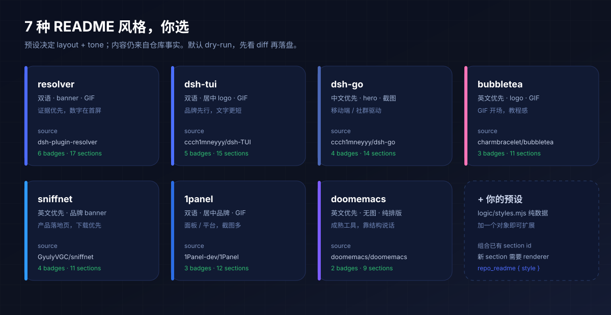
</p>

| id | 风格 | 语言 | 首屏 | demo | 默认图形 | 适合 |
|---|---|---|---|---|---|---|
| `evidence` | 证据优先 | 双语 | banner | GIF | `arcs` | 有基准/测试的工程仓库 |
| `terminal` | 终端工具 | 双语 | 居中 logo | GIF | `prompt` | 有品牌 logo 的命令行工具 |
| `mobile` | 移动端 · 社群 | 中文优先 | banner | 截图 | `orbit` | App / 移动端 / 社群产品 |
| `playful` | GIF 开场 · 教程 | 英文优先 | logo | GIF | `bubble` | TUI / 开发者工具 |
| `product` | 品牌产品页 | 英文优先 | 品牌 banner | 截图 | `radar` | 面向普通用户的产品 |
| `platform` | 面板平台 | 双语 | 居中 logo | GIF | `hexstack` | 面板 / 平台 |
| `minimal` | 极简排版 | 英文优先 | 无图 | 无 | `monogram` | 成熟工具 / 框架 |

选择建议、每个预设的章节顺序、以及“优秀仓库的 12 个共性”写在 [docs/STYLES.md](docs/STYLES.md)。

## 品牌素材

<p align="center">
  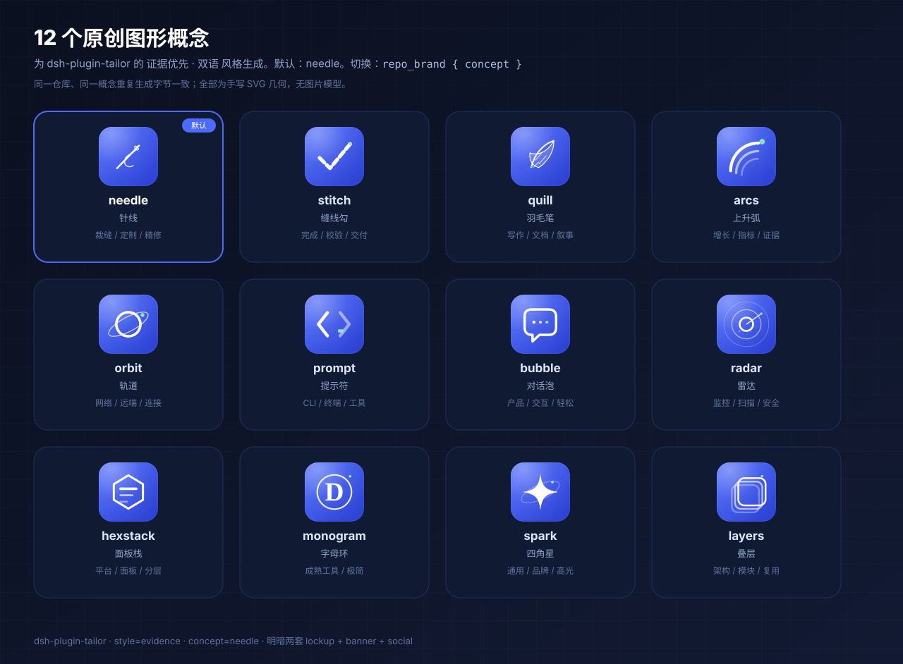
</p>

`repo_brand` 不是换一张模板图，而是从 12 个手写几何概念里选，配上风格调色板和明暗两套版式：

| 概念 | 适合 | 概念 | 适合 |
|---|---|---|---|
| `needle` 针线 | 裁缝 / 定制 / 精修 | `stitch` 缝线勾 | 完成 / 校验 / 交付 |
| `quill` 羽毛笔 | 写作 / 文档 / 叙事 | `arcs` 上升弧 | 增长 / 指标 / 证据 |
| `orbit` 轨道 | 网络 / 远端 / 连接 | `prompt` 提示符 | CLI / 终端 / 工具 |
| `bubble` 对话泡 | 产品 / 交互 / 轻松 | `radar` 雷达 | 监控 / 扫描 / 安全 |
| `hexstack` 面板栈 | 平台 / 面板 / 分层 | `monogram` 字母环 | 成熟工具 / 极简 |
| `spark` 四角星 | 通用 / 品牌 / 高光 | `layers` 叠层 | 架构 / 模块 / 复用 |

一次生成 8 个文件：

| 文件 | 用途 |
|---|---|
| `icon.svg` | 512×512 图标 / 头像 |
| `logo.svg` / `logo-dark.svg` | 浅色 / 深色 lockup |
| `banner.svg` / `banner-light.svg` | 1280×400 深 / 浅横幅 |
| `social-preview.svg` | 1280×640 社交卡 |
| `brand-sheet.svg` | 12 概念对照，默认高亮 |
| `assets/README.md` | 素材索引与切换命令 |

```sh
node bin/tailor.mjs brand . --style=evidence --concept=needle \
  --tagline="From it runs to ship it." --apply --force
```

默认 dry-run 只列文件和概念；`apply` 才写盘，已有文件默认跳过。

## 工具输出

真实 CLI 输出，不是示意图；截图由实际 stdout 渲染，命令写在图里。

<p align="center">
  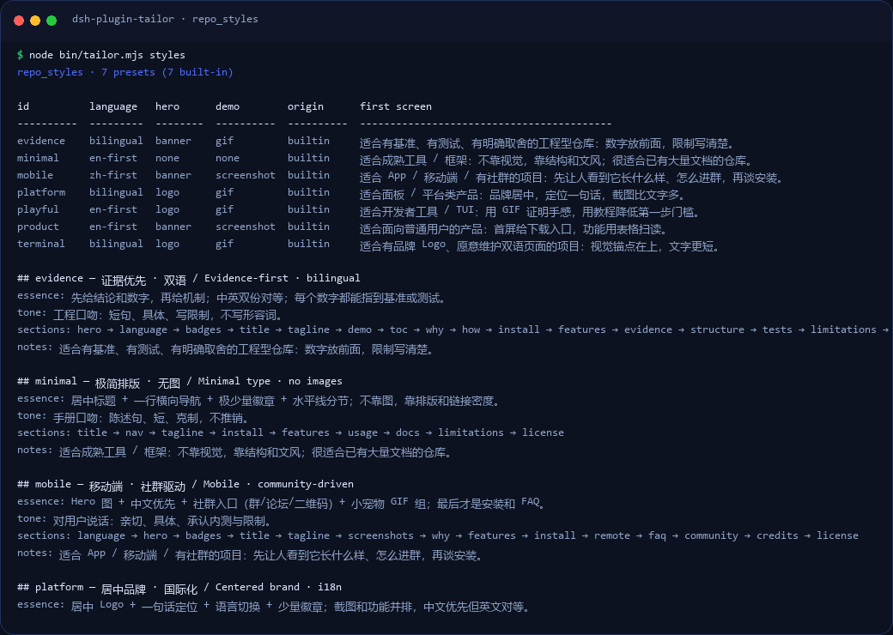
</p>
<p align="center"><sub><code>tailor styles</code>：只描述风格本身，不带仓库名。</sub></p>

<p align="center">
  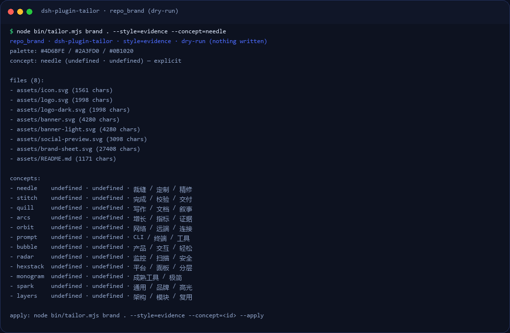
</p>
<p align="center"><sub><code>tailor brand . --style=evidence --concept=needle</code>：dry-run 列出 8 个文件和 12 个概念。</sub></p>

<p align="center">
  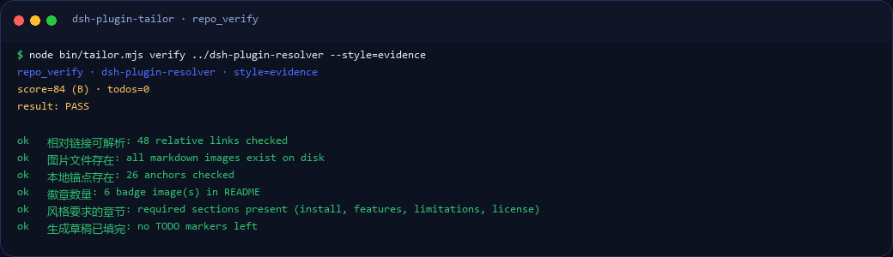
</p>
<p align="center"><sub><code>tailor verify</code>：PASS 时逐项列出链接、图片、锚点、章节与 TODO。</sub></p>

## 效果与证据

<p align="center">
  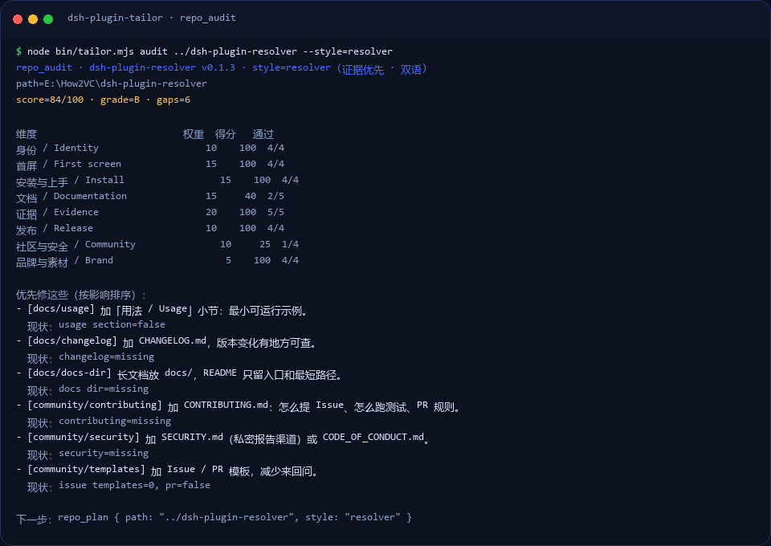
</p>

- **自举**：本仓库用自己补文档/品牌/README，审计分 **37 → 100**（D → A）；`dsh-plugin-resolver` 审计 **84/100（B）**，`repo_verify` 返回 `PASS`。
- **测试**：11 项离线测试（`npm test`，pass 11 / fail 0），CI 在 Node 20/22/24 上跑。
- **纯逻辑耗时**：`auditFacts` **0.01 ms**、`renderReadme` **0.03 ms**、`verifyFacts` **0.03 ms**；`collectFacts` 因为要起 4 个 `git` 子进程约 **109–794 ms**（视仓库大小）。
- **CLI 端到端**：`tailor audit .` 中位数 **248 ms**，其中约 200 ms 是 Node 启动。
- **口径**：环境、方法、输出体积都写在 [BENCHMARK.md](BENCHMARK.md)；自举前后与测试输出在 [docs/EVIDENCE.md](docs/EVIDENCE.md)。

## 结构

```text
index.js            host half：注册工具、热加载 logic
host/register.js    tool schema（稳定，改动需重启）
logic/
  api.js            6 个工具入口
  facts.mjs         只读仓库事实
  rubric.mjs        8 维 34 项检查
  plan.mjs          gaps → P0/P1/P2 任务
  styles.mjs        7 个风格预设（纯数据）
  readme.mjs        双语草稿、diff、apply 安全
  brand.mjs         12 概念品牌引擎（明暗双版）
  verify.mjs        链接/锚点/图片/章节/TODO
  util.mjs          diff、slug、路径边界
bin/tailor.mjs      CLI（和工具共用逻辑）
bench/micro.mjs     纯逻辑基准
docs/               SPEC / STYLES / ACCEPTANCE / EVIDENCE
test/tailor.test.mjs 11 项离线测试
```

## 测试与 CI

```sh
npm test                # 11 项离线测试
node bench/micro.mjs .  # 纯逻辑微基准
node bin/tailor.mjs verify . --style=evidence
```

- 测试覆盖：风格注册、facts、audit 排序、plan、README 渲染/落盘安全、品牌确定性、坏链/坏图/坏锚点、宿主注册、CLI。
- CI：`.github/workflows/test.yml`，Node 20/22/24 矩阵，跑 `npm test`、CLI smoke、`npm pack --dry-run`。

## 已知限制

- **分数衡量结构与证据是否存在，不衡量文笔**：100 分不代表 README 好读，最终判断仍要人做。
- **草稿必须人工校对**：`TODO(tailor)` 是给你填的；`repo_verify` 会把剩余 TODO 作为 warn 报出来。
- **只做 zh / en**，不做其他语言；不自动选风格；不自动 commit / push / 发布。
- **不生成真实截图或图片**：`repo_brand` 只生成 SVG 几何，demo GIF 需要用真实运行日志另外录。
- **品牌素材是几何 SVG，不是插画/摄影**：需要插画级视觉时仍要人或模型来画；`repo_brand` 保证的是概念选择、明暗两套、一致性和可重复生成。
- **`collectFacts` 是主要耗时项**（git 子进程 + 文件遍历），纯判断逻辑可以忽略不计。
- **SVG 字宽依赖系统字体**：Inter / Segoe UI / 微软雅黑，不同机器上文字宽度略有差异。
- npm 尚未发布：现在只能从源码安装，发布流程在 [PUBLISHING.md](PUBLISHING.md)。

## 权限与安全边界

| 动作 | 边界 |
|---|---|
| 读取 | 只读仓库内文件 + `git status/log/tag`；插件自身不联网 |
| 写入（仅 `apply: true`） | `README.md` / `README.en.md` / `assets/*.svg` / `assets/README.md` / `.tailor/baseline.json` |
| 拒绝 | 路径逃逸（`../`）、手写 README 未 `force`、已有素材未 `force`、worktree 脏且未 `force` |
| 不做 | 不执行仓库脚本、不 `npm install`、不 commit / push / 发布、不调用图片模型 |
| 依赖 | 只用 Node 标准库；无运行时依赖 |

## FAQ

**和“README 模板”有什么区别？**
模板给结构；这里给 8 维审计、按风格生成、写保护、发布前校验。事实来自仓库，缺失就写 TODO，不编数字。

**会覆盖我手写的 README 吗？**
默认拒绝。只有带 `generated-by` 标记的文件才允许再生成；否则必须显式 `force`。

**需要联网吗？**
不需要。徽章图片是 GitHub 渲染时去 shields.io 加载的；插件本身不发请求。

**支持哪些语言和风格？**
`zh` / `en` 两种页面；7 种风格：`evidence`、`terminal`、`mobile`、`playful`、`product`、`platform`、`minimal`。旧命令里的 id 仍可用。

**为什么 100 分还要人工看？**
分数只衡量结构、证据、品牌是否存在，不衡量文笔和事实正确性；发布前仍要人读一遍。

**npm 什么时候发？**
见路线图。现在用 GitHub Release 里的 `.tgz`。

## 路线图

- [x] **v0.1** 8 维审计、P0–P2 规划、双语草稿、发布前校验
- [x] **v0.2** 12 个原创图形概念、明暗两套品牌套件、brand-sheet
- [x] **v0.3** 风格去仓库名、真实 CLI 截图、demo 重录
- [ ] **v0.4** npm 发布 + `dsh-plugins` hub 收录
- [ ] **v0.4** `--palette` 配色（暖色 / 高对比 / 单色 / 跟随品牌主色）
- [ ] **v0.5** 同一仓库多风格并排预览（截图，不靠自引用）
- [ ] **v0.5** 可选图像模型插画模式（PNG，不替代 SVG 几何）

## 生态与收录

- 装插件：[`dsh-plugin-resolver`](https://github.com/sakikoTGW/dsh-plugin-resolver)（用一条工具调用装对版本）
- 索引：[`dsh-plugins`](https://github.com/sakikoTGW/dsh-plugins)（`catalog.json` 是唯一事实源）
- 移动端适配：[`dsh-plugin-resolver-dshgo`](https://github.com/sakikoTGW/dsh-plugin-resolver-dshgo)
- 收录状态：GitHub Release ✅ · npm ⏳ · hub catalog ⏳

## 反馈与安全

- 问题与建议：<https://github.com/sakikoTGW/dsh-plugin-tailor/issues>
- 安全问题：请走 **Security → Advisories → Report a vulnerability**（私密报告，见 [SECURITY.md](SECURITY.md)）
- 贡献指南：[CONTRIBUTING.md](CONTRIBUTING.md) · 发布流程：[PUBLISHING.md](PUBLISHING.md)

## License

[MIT](LICENSE)

<p align="center">
  <sub>Built for <a href="https://github.com/deepseek-ai/deepseek-harness">DeepSeek Harness</a> · 属于 <a href="https://github.com/sakikoTGW/dsh-plugins">dsh-plugins</a> 插件集 · <a href="#dsh-plugin-tailor">回到顶部 ↑</a></sub>
</p>
<p align="center">
  <sub>如果它帮你省了时间，点个 ⭐ 让更多人看到。</sub>
</p>
