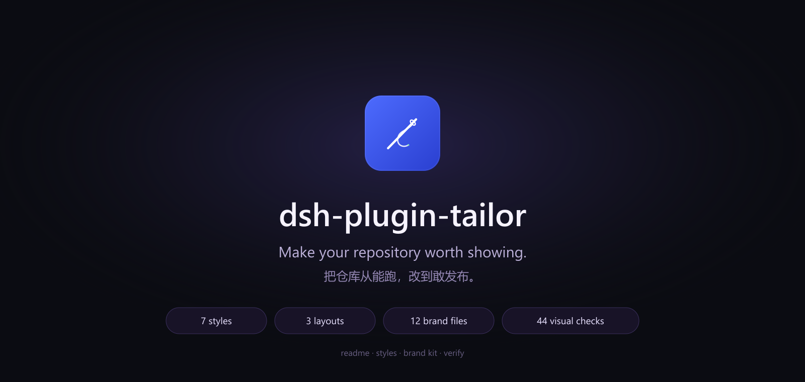
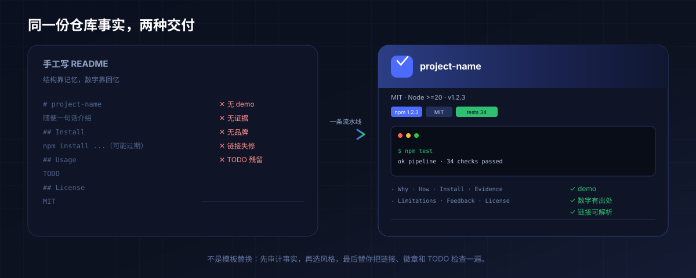
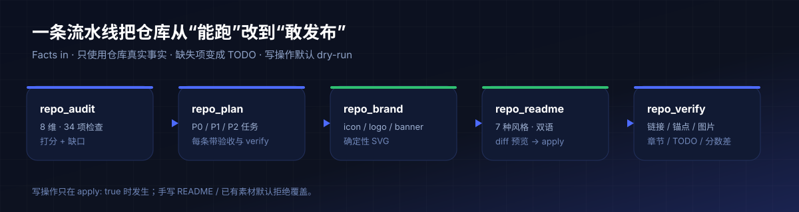

<p align="center">
  
</p>

<p align="center">
  <b>简体中文</b> · <a href="README.en.md">English</a>
</p>

<p align="center">
  <a href="https://www.npmjs.com/package/dsh-plugin-tailor"></a>
  
  
  
  <a href="LICENSE"></a>
  
  
</p>

<p align="center"><sub><b>44 项检查</b> · <b>18/18 测试</b> · <b>7 种风格</b> · <b>3 套版式</b> · <b>12 个品牌文件</b> · MIT</sub></p>

## 效果

<p align="center">
  
</p>

<p align="center"><sub>同一仓库：手工 README → tailor 生成。首屏、demo、证据、品牌、链接检查一次成型。</sub></p>

本仓库就是用自己重写的：审计分 **37 → 100**（D → A），`dsh-plugin-resolver` 用同一套工具做到 **81/100 · verify PASS**。

## 安装

```sh
# 1) DSH 插件（推荐）
dsh plugin --profile <profile> add dsh-plugin-tailor

# 2) CLI（不需要 DSH）
npm install -g dsh-plugin-tailor
dsh-repo-tailor styles

# 3) 离线：源码或 Release tarball
git clone https://github.com/sakikoTGW/dsh-plugin-tailor
```

把这句话交给你的 agent：

```text
用 dsh-plugin-tailor 审计这个仓库，按 product 风格重写 README 和品牌素材，最后跑 verify。
```

## 怎么工作

<p align="center">
  
</p>

| 阶段 | 工具 | 结果 |
|---|---|---|
| 审计 | `repo_audit` | 8 维 44 项、0–100 分、按影响排序的缺口 |
| 规划 | `repo_plan` | P0/P1/P2 任务，每条带验收与 verify 命令 |
| 品牌 | `repo_brand` | 12 个确定性 SVG + 对比度 QA |
| README | `repo_readme` | 双语草稿、版式引擎、diff、写保护 |
| Agent 层 | `repo_agent` | `agent.json`、`llms.txt`、`docs/*.md` 渲染成带导航的静态站点 |
| 校验 | `repo_verify` | 链接、图片、锚点、章节、TODO、PASS/FAIL |

写操作默认 dry-run；手写 README 与已有素材默认保留，`force` 才覆盖。

## 生态

- [dsh-plugins](https://github.com/sakikoTGW/dsh-plugins) — 插件集与 catalog
- [dsh-plugin-resolver](https://github.com/sakikoTGW/dsh-plugin-resolver) — 用一条工具调用装对插件
- npm：[dsh-plugin-tailor](https://www.npmjs.com/package/dsh-plugin-tailor)
- 风格目录与 schema：[styles/README.md](styles/README.md)

## 能力矩阵

| 工具 | 读写 | 输入 | 输出 |
|---|---|---|---|
| `repo_styles` | 读 | `path?`, `json?` | 内置 + 自定义风格、来源、校验错误 |
| `repo_audit` | 读 | `path`, `style?` | 分数、维度明细、gaps |
| `repo_plan` | 读 | `path`, `style?`, `limit?` | P0/P1/P2 + acceptance + verify |
| `repo_readme` | dry-run / 写 | `path`, `style?`, `lang?`, `apply?`, `force?` | diff、TODO、风格缺口 |
| `repo_brand` | dry-run / 写 | `path`, `style?`, `concept?`, `apply?`, `force?` | 12 个品牌文件 |
| `repo_agent` | dry-run / 写 | `path`, `style?`, `apply?`, `force?`, `docs?` | `agent.json`、`llms.txt`、docs 站点 |
| `repo_verify` | 读 | `path`, `style?` | PASS/FAIL、逐项检查、剩余 TODO |

## 能力（Features）

- **7 种风格 + 3 套版式** — 内置风格是 JSON；`editorial` / `centered` / `showcase` 由 `visual` 字段配置。
- **自定义风格** — 放在 `.tailor/styles/` 或 `~/.tailor/styles/`，支持 `extends` 与 schema 校验。
- **12 文件品牌套件** — icon / maskable / 明暗 logo / 明暗 wordmark / 明暗 banner / social / brand-sheet / tokens / 索引。
- **视觉 QA** — 调色板 WCAG 对比度、14 项品牌与视觉检查。
- **双语** — zh / en 结构对等，同一套事实源。
- **Agent 层** — `repo_agent` 从 `package.json` 和 `host/register.js` 生成契约骨架、`llms.txt` 和 docs 站点；语义缺口留成显式 TODO，不编造。
- **发布前校验** — 坏链、坏图、坏锚点、缺失章节、剩余 TODO，一条命令 PASS/FAIL。

## 验证

```sh
npm test                                         # 20/20
node bin/tailor.mjs verify . --style=evidence    # PASS
node bin/tailor.mjs audit . --style=evidence     # 100/100
node bin/tailor.mjs agent . --style=product      # dry-run: agent.json, llms.txt, docs site
```

## Agent contract

```json
{
  "tools": ["repo_styles", "repo_audit", "repo_plan", "repo_readme", "repo_brand", "repo_agent", "repo_verify"],
  "styles": "JSON presets with extends + schema validation",
  "writes": ["README.md", "README.en.md", "assets/*.svg", "assets/README.md", "agent.json", "llms.txt", "docs/*.html", ".tailor/baseline.json"],
  "safety": "dry-run default; hand-written README, assets and agent files preserved unless force",
  "verify": "links, images, anchors, required sections, remaining TODO"
}
```

## 结语

把仓库从能跑，改到敢发布。

[npm](https://www.npmjs.com/package/dsh-plugin-tailor) · [GitHub](https://github.com/sakikoTGW/dsh-plugin-tailor) · [Issues](https://github.com/sakikoTGW/dsh-plugin-tailor/issues) · [dsh-plugins](https://github.com/sakikoTGW/dsh-plugins)

<p align="center"><sub>Built for <a href="https://github.com/deepseek-ai/deepseek-harness">DeepSeek Harness</a> · MIT · <a href="#">回到顶部 ↑</a></sub></p>

