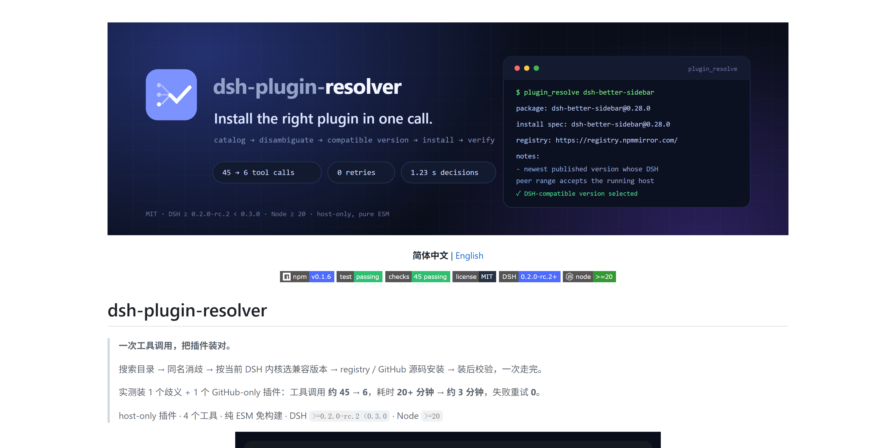
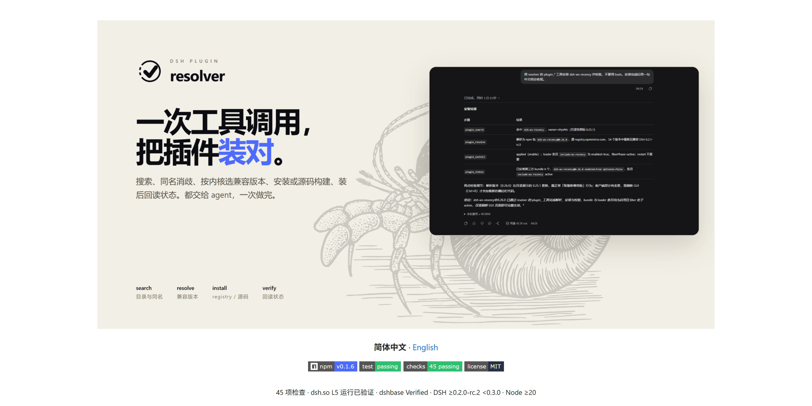
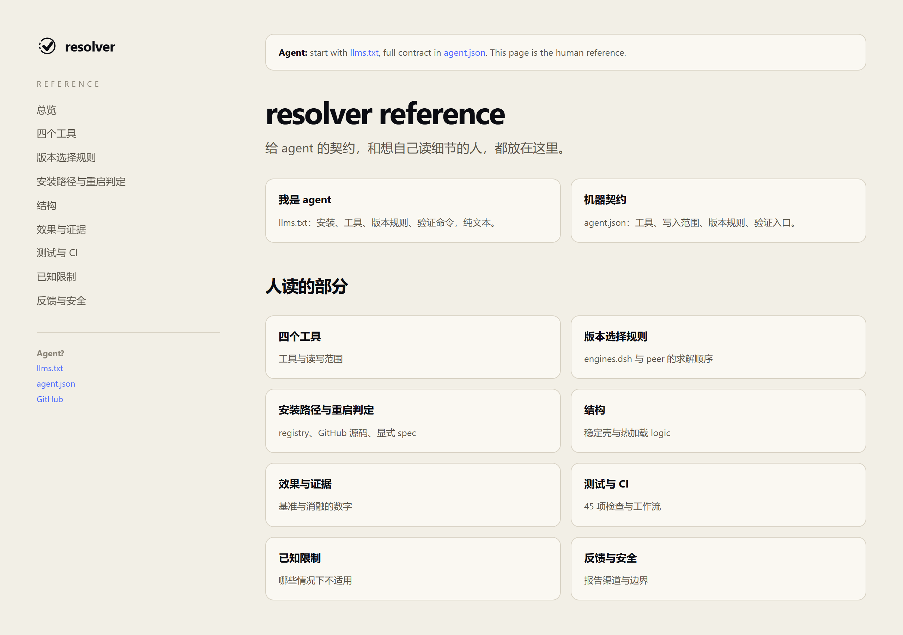
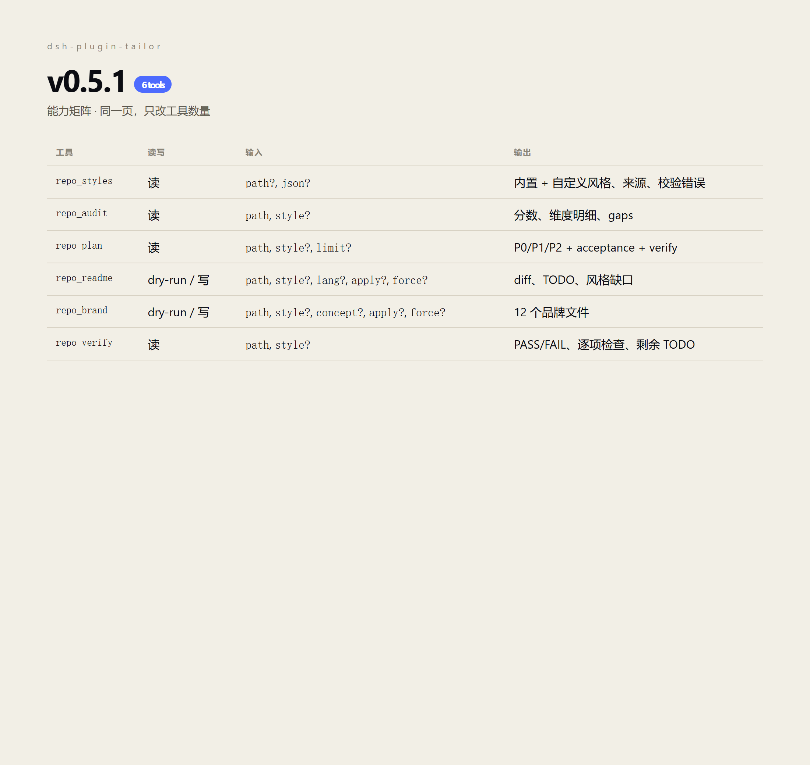
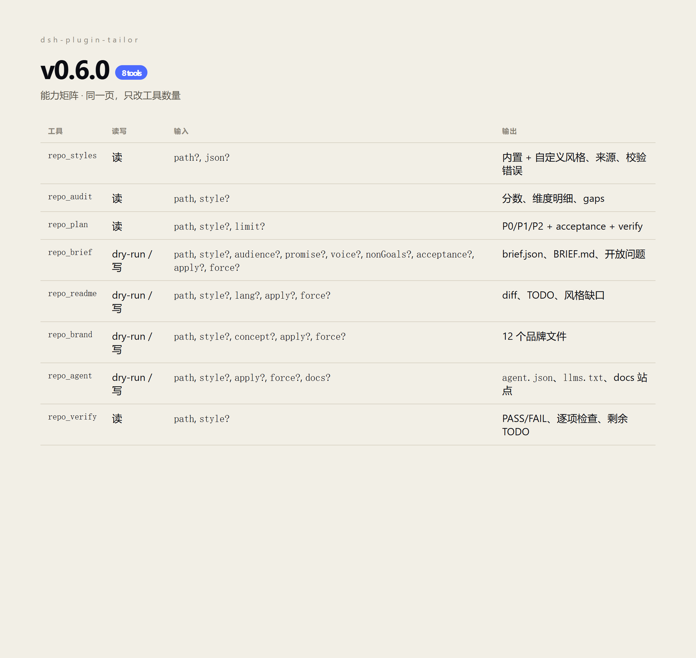
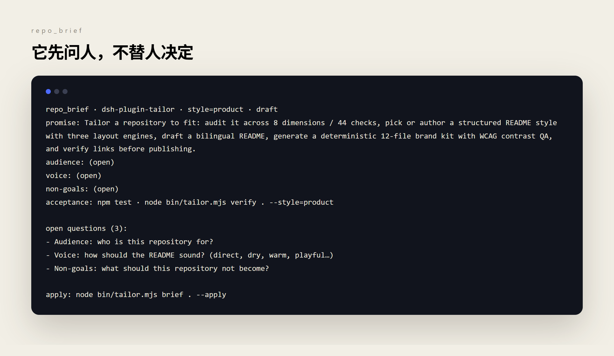
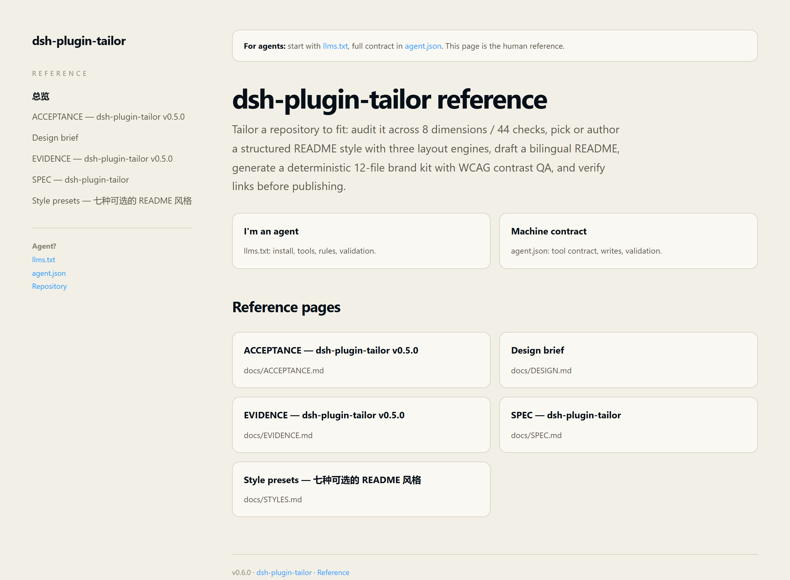

# v0.6.0 — 把人的判断写进仓库

Status: **released** — GitHub + npm
Compare: https://github.com/sakikoTGW/dsh-plugin-tailor/compare/v0.5.1...v0.6.0
Release: https://github.com/sakikoTGW/dsh-plugin-tailor/releases/tag/v0.6.0
npm: https://www.npmjs.com/package/dsh-plugin-tailor/v/0.6.0

## 一句话

tailor 从“生成 README”变成“先记下人的判断，再让 agent 生成契约和文档”。resolver 的改造是案例，不是这版的主题。

## 改了什么 → 改后效果

| 改了什么 | 之前 | 之后 | 证据 |
|---|---|---|---|
| 新增 `repo_brief` | 没有共同判断，agent 自己猜受众和语气 | `.tailor/brief.json` 记录 promise、audience、voice、non-goals、acceptance；没回答的项是 open question | `repo_brief` dry-run 返回 3 个问题；回答后 `brief is ready`，写出 JSON + BRIEF.md |
| 新增 `repo_agent` | 只有 README，agent 拿不到结构化契约 | `agent.json` + `llms.txt` + 从 `docs/*.md` 生成的静态站点 | 对 resolver dry-run：4 个工具、8 个页面、12 个文件；fixture apply 写出 5 个文件，重跑全部 skipped |
| 工具从 6 个到 8 个 | 流程到 README 和品牌为止 | 多了 brief 和 agent 两层，人和 agent 的交接有文件 | `npm test` 21/21；host 注册 8 个工具 |
| 发布报告成为产物 | 发版只有 CHANGELOG，图和素材散落 | `RELEASE_TEMPLATE.md`、`.github/release.yml`、before/after 截图、契约和证据文件 | 本报告；`docs/releases/v0.6.0/` |

## 和上一版的区别

| 维度 | v0.5.1 | v0.6.0 | 影响 |
|---|---|---|---|
| 工具 | 6 | 8 | 新增 `repo_brief`、`repo_agent` |
| 人的决定 | 散落在对话里 | `.tailor/brief.json` + `BRIEF.md` | 人要先回答三个问题；agent 不再猜 |
| Agent 层 | 没有 | `agent.json` + `llms.txt` + docs 站点 | agent 不用只读 README |
| 默认行为 | 已有工具 dry-run | 新工具同样 dry-run；手写文件默认保留 | 升级不会覆盖已有仓库 |
| 契约 | 只描述 README/品牌 | 多了 `brief`、`humanDecisions`、agent layer | 调用方要读新字段 |
| 兼容性 | Node ≥20 / DSH 范围不变 | 不变 | 无破坏性变更 |

谁需要做什么：

- 新用户：先跑 `brief`，再跑 `agent`，然后才决定要不要生成 README。
- 已有用户：不跑新工具就完全不受影响。
- 调用方 / agent：读 `agent.json` 的 `brief` 和 `humanDecisions`；不要绕过 open questions。

## 案例：resolver 的几天前 → 现在

这是案例，不是 v0.6.0 的功能产物。resolver 的改造发生在 `repo_brief` / `repo_agent` 之前；它暴露的问题被抽象成了这两个工具：人的判断没有地方放，agent 只能从 README 散文里猜。

| 指标 | v0.1.3（几天前） | v0.1.6（现在） |
|---|---|---|
| README | 282 行 / 14 节 / 22 图 / 6 徽章 | 142 行 / 9 节 / 8 图 / 4 徽章 |
| 首屏 | 渐变横幅 + 3 个指标胶囊 + 终端 | 纸色海报 + 真实 DSH 窗口 + 版画水印 |
| Agent 层 | 无 | `llms.txt` + `agent.json` + 9 页 docs |
| 验证 | 45 项 / 81 B | 45 项 / 84 B |
| 工具契约 | 4 个 | 4 个，不变 |

| 老版本 README | 当前 README |
|---|---|
|  |  |



完整案例：https://github.com/sakikoTGW/dsh-plugin-resolver/blob/main/docs/cases/resolver.md

## tailor 自身的对比

| 之前 v0.5.1 | 之后 v0.6.0 |
|---|---|
|  |  |

图注：同一张能力矩阵，只多了 `repo_brief` 和 `repo_agent`。



图注：它先问人，不替人决定；这是 v0.5.1 没有的一层。



图注：`repo_agent` 把 `docs/*.md` 渲染成 agent/人两个入口的站点。

## 素材

| 文件 | 说明 | 来源 |
|---|---|---|
| `before-tools.png` | v0.5.1 能力矩阵（6 工具） | `git worktree` at `v0.5.1` |
| `after-tools.png` | v0.6.0 能力矩阵（8 工具） | 当前 worktree |
| `brief-questions.png` | `repo_brief` 真实 dry-run 输出 | `node bin/tailor.mjs brief . --style=product` |
| `docs-site.png` | `repo_agent` 生成的 docs 首页 | 临时副本上 `repo_agent --apply` |
| `agent-before.json` | v0.5.1 没有 agent 层 | tag |
| `agent-after.json` | v0.6.0 生成的契约 | `repo_agent --apply` |
| `case-resolver-before.png` | 案例：resolver v0.1.3 README 首屏 | resolver `git worktree` + 本地渲染 |
| `case-resolver-after.png` | 案例：resolver v0.1.6 README 首屏 | 当前 resolver |
| `case-resolver-docs.png` | 案例：resolver docs 首页 | GitHub Pages |
| `evidence.txt` | 测试、verify、dry-run 输出 | 真实命令 |

## 升级路径

```sh
npm i -D dsh-plugin-tailor@0.6.0
```

从 v0.5.1 升级：

```sh
node bin/tailor.mjs brief . --style=product
node bin/tailor.mjs agent . --style=product --apply
```

## 破坏性变更

无。两个新工具都是增量；已有 `repo_readme`、`repo_brand`、`repo_verify` 的输入输出不变。

## 已知问题

- `repo_brief` 目前只被 `repo_agent` 消费；`repo_readme` 和 `repo_brand` 还没读它，`repo_verify` 也还没检查成品是否和 brief 一致。
- 案例里的 resolver 改造是手工样板，不是 `repo_agent` 生成；`repo_agent` 是后来从这次改造里抽象出来的。
- docs 站点的 Markdown 渲染器只覆盖标题、表格、代码、列表、引用、链接/图片；复杂 MD 不保证。
- `docs-site.png` 里的页面标题还写着 v0.5.0，因为 `docs/*.md` 的内容版本没改；页脚是 v0.6.0。

## 证据

```text
npm test                                   → 21 passing, 0 failing
repo_verify (style=product)                → 97/A PASS
repo_agent on resolver (dry-run)           → tools inferred: 4 · docs pages: 8 · files: 12
repo_agent on fixture (apply)              → written: agent.json, llms.txt, docs/tools.html, docs/index.html, docs/style.css
repo_agent on fixture (second apply)       → written: none · skipped: all
```
